# Cuidar+ — Cuidado que conecta


O **Cuidar+** é uma plataforma desenvolvida para aproximar pessoas acompanhadas, familiares e profissionais de cuidado, facilitando a organização da rotina, o acompanhamento de atividades e o compartilhamento de informações.

A proposta é tornar o cuidado mais organizado, acessível e colaborativo, respeitando a autonomia de cada pessoa e fortalecendo a comunicação entre os envolvidos.

## Objetivo do projeto

O projeto busca centralizar informações importantes da rotina de cuidados em um único ambiente, permitindo que cada usuário tenha acesso a funcionalidades adequadas ao seu perfil.

A plataforma contempla três tipos de usuários:

- **Pessoa acompanhada:** pode acompanhar sua rotina e consultar informações relacionadas aos próprios cuidados.
- **Familiar:** pode organizar atividades, compromissos e acompanhar a rotina da pessoa sob seus cuidados.
- **Cuidador:** pode apresentar seu perfil profissional e participar da rede de apoio.

## Tecnologias utilizadas

- React
- Vite
- TypeScript
- Tailwind CSS
- React Router DOM
- Lucide React
- Fetch API
- Java — API REST (Back-End)

## Demonstração da aplicação

### Páginas institucionais

| Página inicial | Sobre |
|:---:|:---:|
| 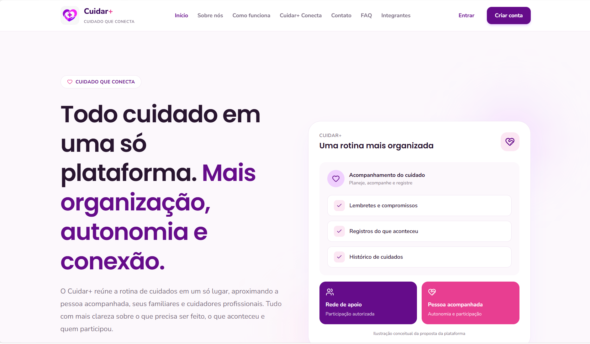 | 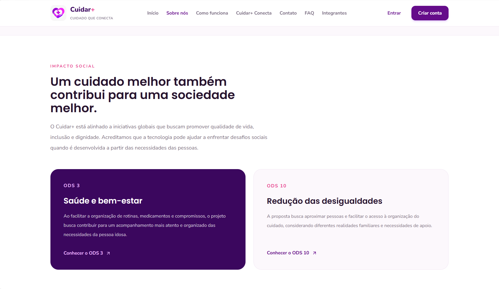 |

| Solução | Conecta |
|:---:|:---:|
| 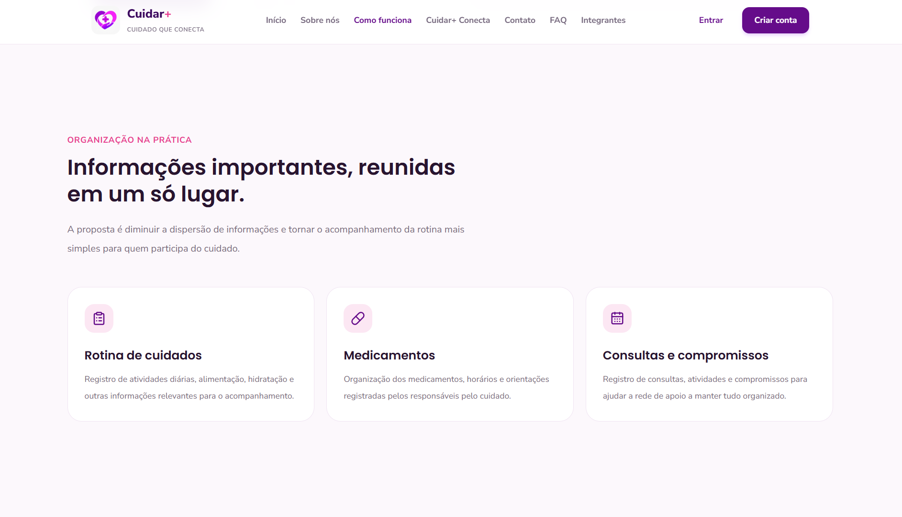 | 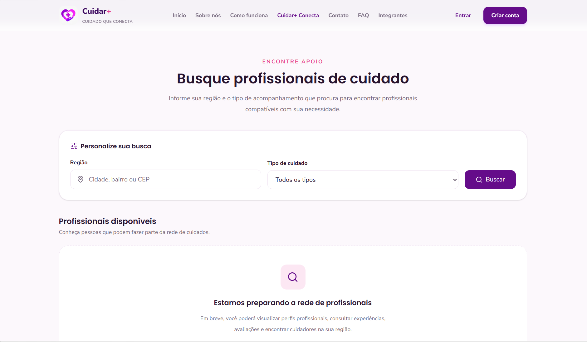 |

| Contato | FAQ |
|:---:|:---:|
| 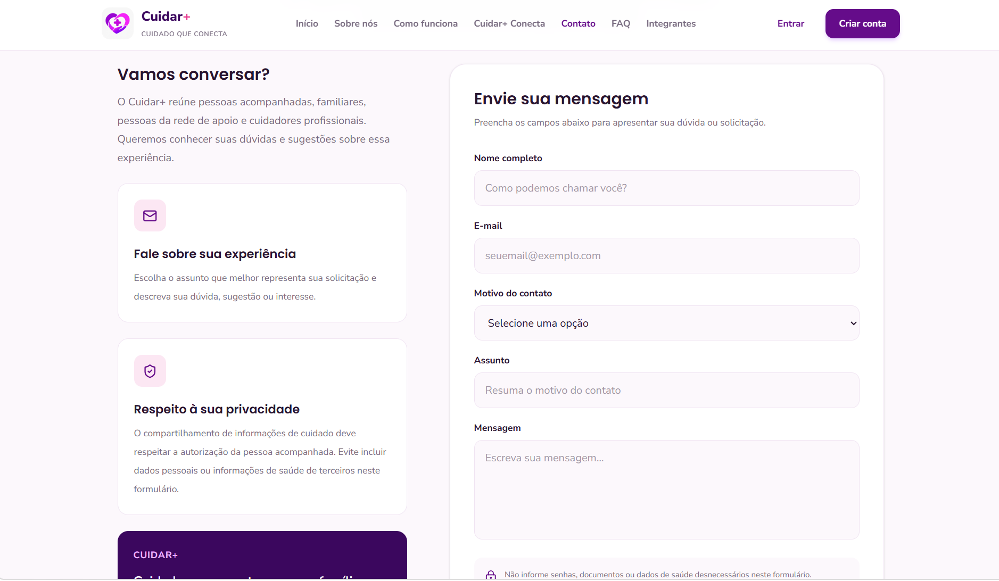 | 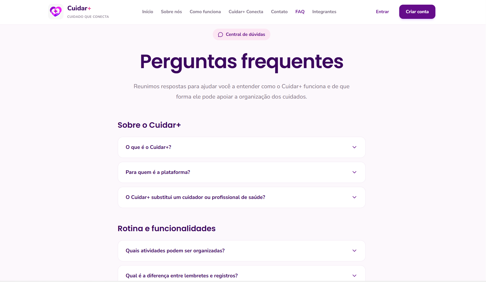 |

| Integrantes | |
|:---:|:---:|
| 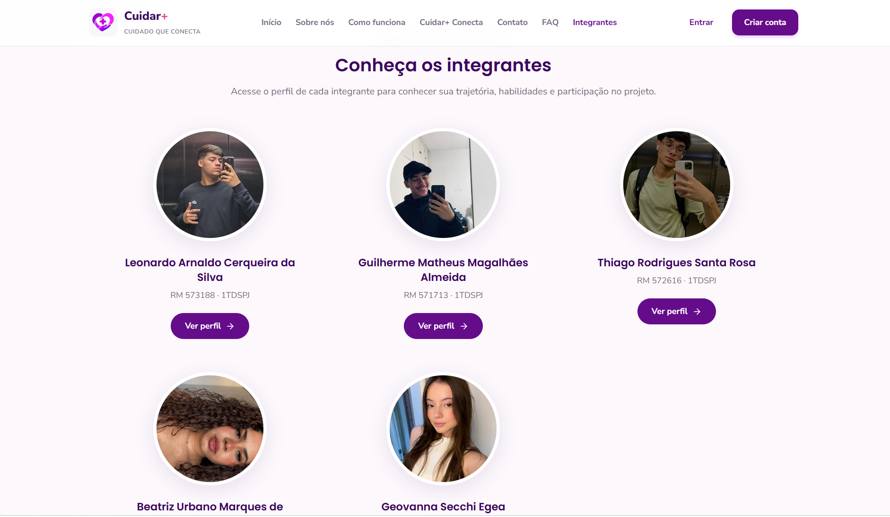 | |

### Cadastro e autenticação

| Cadastro | Login |
|:---:|:---:|
| 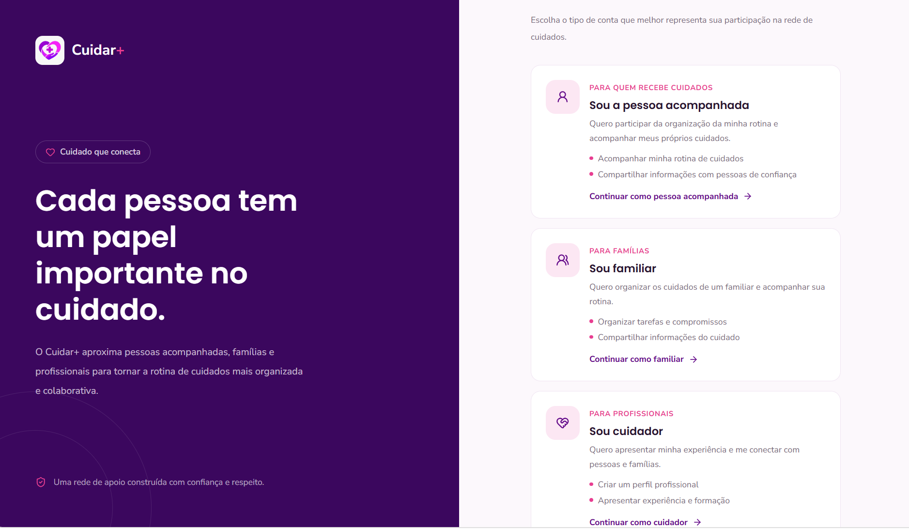 | 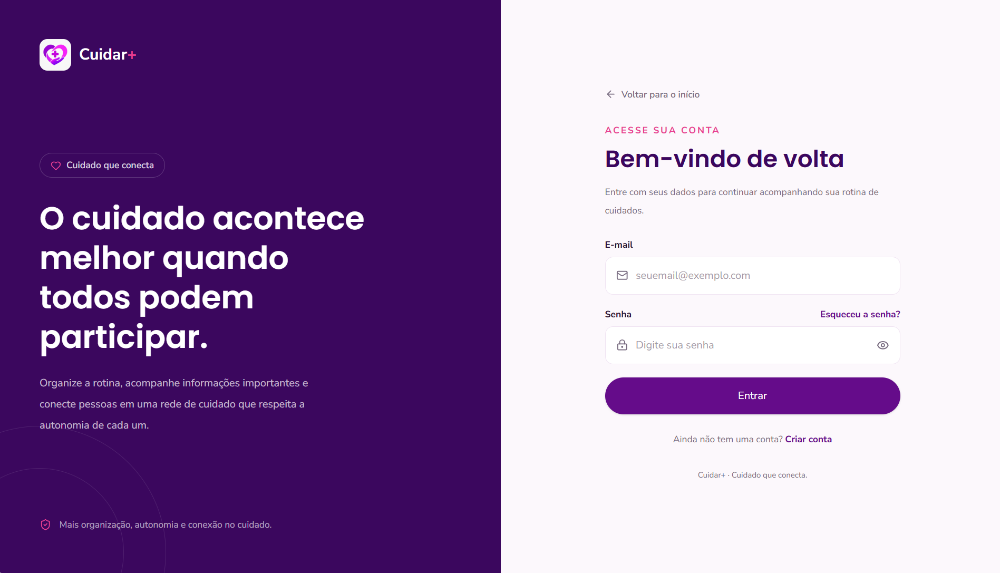 |

### Cadastro por perfil

| Pessoa acompanhada | Familiar |
|:---:|:---:|
| 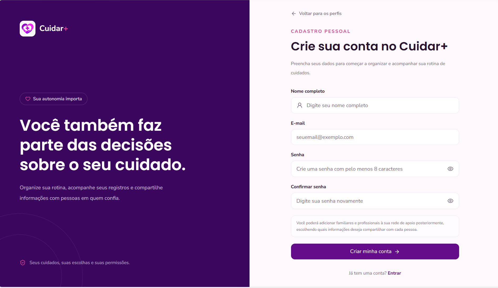 | 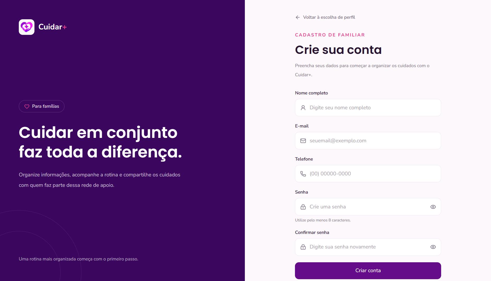 |

| Cuidador | |
|:---:|:---:|
| 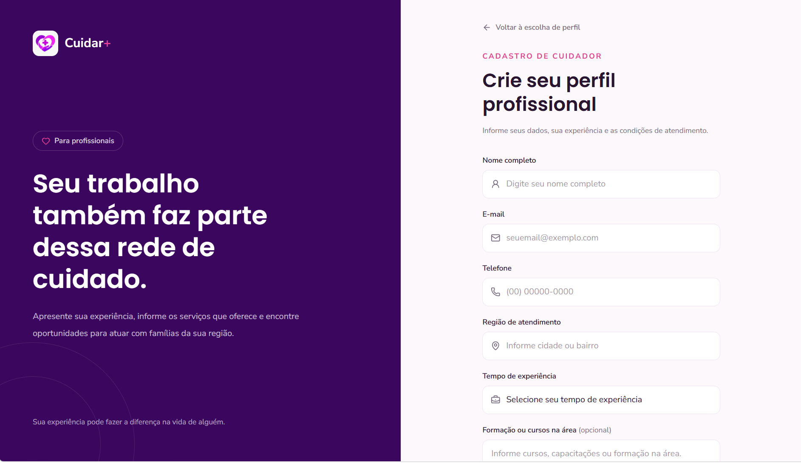 | |

### Dashboards

| Pessoa acompanhada | Familiar |
|:---:|:---:|
| 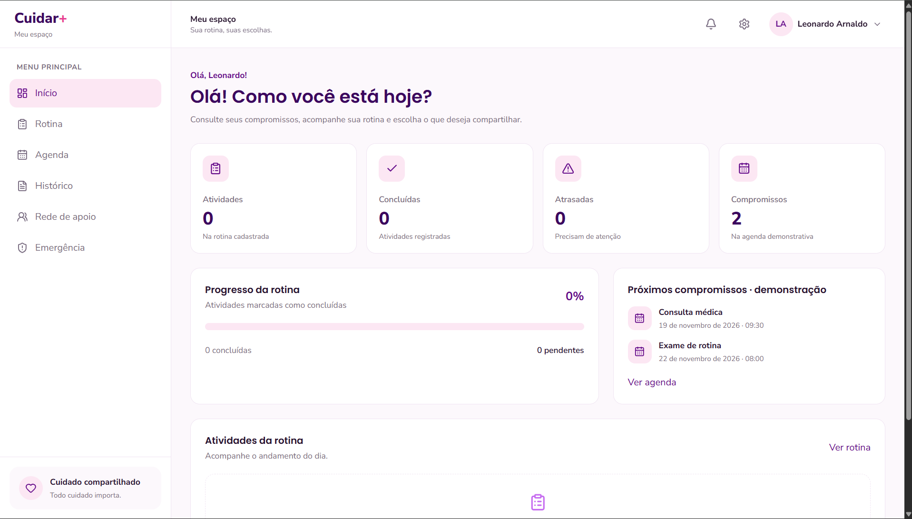 | 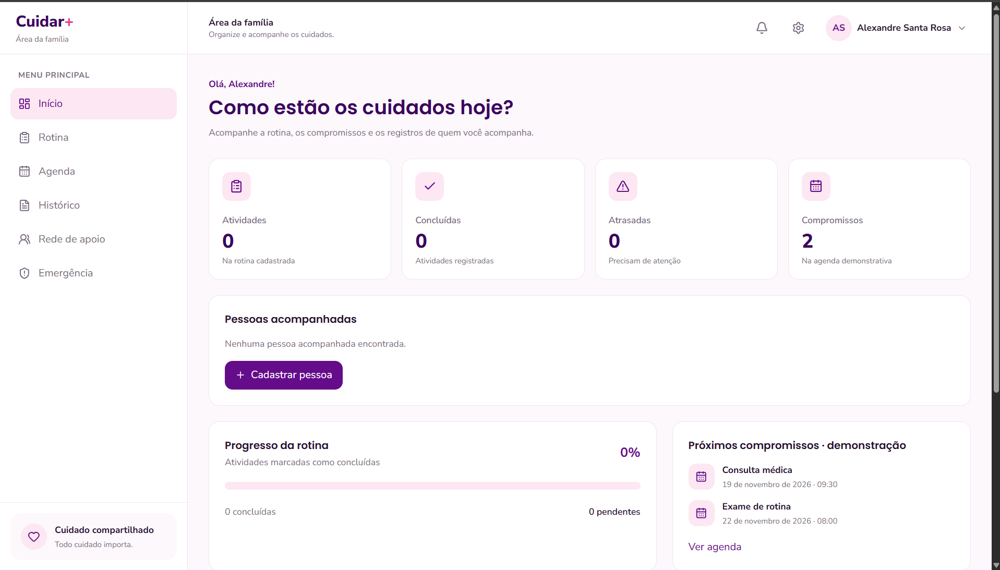 |

| Cuidador | |
|:---:|:---:|
| 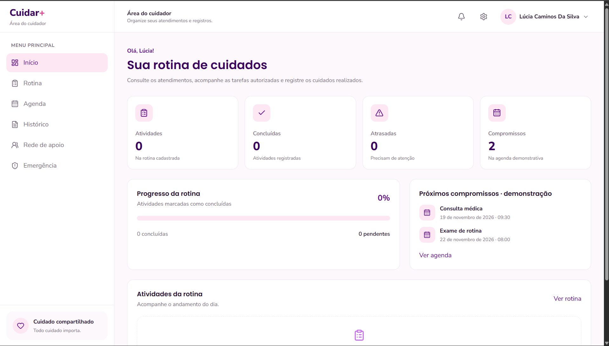 | |

## Funcionalidades

- Página inicial com apresentação da plataforma.
- Páginas institucionais: Sobre, Solução, FAQ, Contato e Integrantes.
- Cadastro separado por perfil de usuário.
- Login e gerenciamento de sessão.
- Redirecionamento conforme o perfil da conta.
- Dashboards específicos para pessoa acompanhada, familiar e cuidador.
- Organização da rotina de cuidados.
- Acompanhamento de atividades e compromissos.
- Histórico de registros.
- Rede de apoio.
- Interface responsiva para diferentes tamanhos de tela.

## Estrutura do projeto

A aplicação foi organizada de maneira modular, separando autenticação, componentes reutilizáveis, páginas, dados e serviços responsáveis pela comunicação com a API.

```text
CUIDAR-PLUS/
│
├── public/
│   └── assets/
│       ├── img01-logo-cuidar.jpeg
│       ├── img02-leonardo.jpeg
│       ├── img03-guilherme.jpeg
│       ├── img04-thiago.jpeg
│       ├── img05-beatriz.jpeg
│       ├── img06-geovanna.jpeg
│       ├── img07-home.png
│       ├── img08-sobre.png
│       ├── img09-solucao.png
│       ├── img10-conecta.png
│       ├── img11-contato.png
│       ├── img12-faq.png
│       ├── img13-integrantes.png
│       ├── img14-cadastro.png
│       ├── img15-login.png
│       ├── img16-cadastropessoa.png
│       ├── img17-cadastrofamiliar.png
│       ├── img18-cadastroc cuidador.png
│       ├── img20-dashboardcuidador...
│       ├── img21-dashboardpessoa.png
│       └── img22-dashboardfamiliar.png
│
├── src/
│   ├── auth/
│   │   └── Session.tsx
│   │
│   ├── components/
│   │   ├── CadastroPessoa/
│   │   │   └── index.tsx
│   │   ├── Dashboard/
│   │   │   ├── index.tsx
│   │   │   ├── PreferenciasPessoa.tsx
│   │   │   ├── RedeApoio.tsx
│   │   │   ├── RotinaCuidados.tsx
│   │   │   ├── usePermissaoPessoa.ts
│   │   │   └── usePessoasAcompanhadas...
│   │   ├── Footer/
│   │   │   └── index.tsx
│   │   └── Header/
│   │       └── index.tsx
│   │
│   ├── data/
│   │   └── members.ts
│   │
│   ├── routes/
│   │   ├── Cadastro/
│   │   │   └── index.tsx
│   │   ├── CadastroCuidador/
│   │   │   └── index.tsx
│   │   ├── CadastroFamiliar/
│   │   │   └── index.tsx
│   │   ├── CadastroPessoa/
│   │   │   └── index.tsx
│   │   ├── Conecta/
│   │   │   └── index.tsx
│   │   ├── Contato/
│   │   │   └── index.tsx
│   │   ├── DashboardCuidador/
│   │   │   └── index.tsx
│   │   ├── DashboardFamiliar/
│   │   │   └── index.tsx
│   │   ├── DashboardPessoa/
│   │   │   └── index.tsx
│   │   ├── Faq/
│   │   │   └── index.tsx
│   │   ├── Home/
│   │   │   └── index.tsx
│   │   ├── Integrantes/
│   │   │   └── index.tsx
│   │   ├── Login/
│   │   │   └── index.tsx
│   │   ├── PerfilIntegrante/
│   │   │   └── index.tsx
│   │   ├── Sobre/
│   │   │   └── index.tsx
│   │   └── Solucao/
│   │       └── index.tsx
│   │
│   ├── services/
│   │   ├── api.ts
│   │   ├── auth.ts
│   │   ├── pessoasAcompanhadas.ts
│   │   ├── registrosCuidado.ts
│   │   └── vinculosProfissionais.ts
│   │
│   ├── App.css
│   ├── App.tsx
│   ├── index.css
│   └── main.tsx
│
├── .env.example
├── .gitignore
├── index.html
├── package.json
├── package-lock.json
├── README.md
├── tsconfig.json
├── tsconfig.app.json
├── tsconfig.node.json
├── vercel.json
└── vite.config.ts
```


## Como executar o projeto

### Pré-requisitos

- Node.js instalado.
- npm instalado.
- Git instalado.

### Instalação

Clone o repositório:

```bash
git clone LINK_DO_REPOSITORIO.git
```

Entre na pasta do projeto:

```bash
cd CUIDAR-PLUS
```

Instale as dependências:

```bash
npm install
```

Configure as variáveis de ambiente conforme o arquivo `.env.example`.

Inicie o servidor de desenvolvimento:

```bash
npm run dev
```

A aplicação estará disponível no endereço local informado pelo Vite no terminal, normalmente `http://localhost:5173`.

## API e Back-End

O projeto utiliza uma arquitetura de serviços para organizar a comunicação entre o Front-End e a API REST desenvolvida em Java.

Os serviços estão separados na pasta `src/services`, incluindo arquivos destinados à autenticação, consulta de pessoas acompanhadas, registros de cuidado e vínculos profissionais.

**URL da API:** [https://cuidar-java.onrender.com/](https://cuidar-java.onrender.com/)

## Deploy

**Aplicação publicada:** [Cuidar+ — Vercel](https://cuidar-front.vercel.app/)

**Repositório GitHub:** [Cuidar — GitHub](https://github.com/Cuidar-Global-Solution)

## Vídeo de apresentação

O vídeo apresenta a proposta do Cuidar+, suas principais funcionalidades, os perfis de acesso e a demonstração da aplicação.

**YouTube:** https://youtu.be/rtLToGb0z1k  


## Integrantes

| Leonardo Arnaldo Cerqueira da Silva | Guilherme Matheus Magalhães Almeida | Thiago Rodrigues Santa Rosa |
|:---:|:---:|:---:|
|  |  |  |
| **Front-End** | **Java** | **Python e Software Engineering** |
| RM 573188 · 1TDSPJ | RM 571713 · 1TDSPJ | RM 572616 · 1TDSPJ |
| [GitHub](https://github.com/LeonardoSilva1203) · [LinkedIn](https://www.linkedin.com/in/leonardo-cerqueira-12a400400/) | [GitHub](https://github.com/guimmalmd) · [LinkedIn](https://www.linkedin.com/in/guimmalmeida/) | [GitHub](https://github.com/Thiagordsr) · [LinkedIn](https://www.linkedin.com/in/thiago-rodrigues-santa-rosa-39b3b3305/) |

| Beatriz Urbano Marques de Oliveira | Geovanna Secchi Egea |
|:---:|:---:|
|  |  |
| **IA** | **Banco de Dados e Software Engineering** |
| RM 569341 · 1TDSPJ | RM 573452 · 1TDSPJ |
| [GitHub](https://github.com/BeaUrbano) · [LinkedIn](https://www.linkedin.com/in/beatriz-urbano-5a9bab254/) | [GitHub](https://github.com/geovannasecchi) · [LinkedIn](https://www.linkedin.com/in/geovanna-secchi-egea-3194553b5/) |

## Contato

Para dúvidas ou informações sobre o projeto, entre em contato com a equipe por meio dos canais disponibilizados no repositório.

---

**Cuidar+ — Cuidado que conecta.**